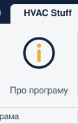
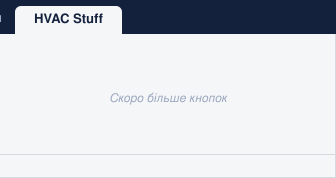

  

  
  
  
  

<!-- ribbon:start -->

<a href="manuals/QuickFlexConnect-uk.pdf" title="З’єднати гофрою — гнучкий повітропровід між двома конекторами за два кліки. Однакові розміри — одразу, різні — вікно з розміром і живим переглядом. Серія пар до Esc.  [Посібник (PDF)]"><picture><source media="(prefers-color-scheme: dark)" srcset="docs/ribbon/img/col-QuickFlexConnect-uk-dark.svg"></picture></a><a href="manuals/FlexTail-uk.pdf" title="Врізати гофру — кінець жорсткого повітроводу біля елемента стає гнучким. Швидкі значення 500–2500 мм, «Вся ділянка», серія елементів.  [Посібник (PDF)]"><picture><source media="(prefers-color-scheme: dark)" srcset="docs/ribbon/img/col-FlexTail-uk-dark.svg"></picture></a><a href="https://github.com/iMrVoLaNd/HVAC-Stuff-Releases/releases/latest" title="Налаштування — мова інтерфейсу, колір і вигляд гнучкого повітроводу при попередньому перегляді, параметри кожної команди."><picture><source media="(prefers-color-scheme: dark)" srcset="docs/ribbon/img/col-Settings-uk-dark.svg"></picture></a><a href="https://github.com/iMrVoLaNd/HVAC-Stuff-Releases/releases/latest" title="Про програму — версія й перевірка оновлень, посібники, папка з налаштуваннями й журналами, автор, ліцензія та подяки."><picture><source media="(prefers-color-scheme: dark)" srcset="docs/ribbon/img/col-About-uk-dark.svg"></picture></a><picture><source media="(prefers-color-scheme: dark)" srcset="docs/ribbon/img/col-rest-uk-dark.svg"></picture>

<!-- ribbon:end -->

**HVAC Stuff** — набір плагінів Revit для спеціалістів систем опалення, вентиляції та кондиціювання. Набір росте; зараз у ньому
два плагіни для гнучких повітроводів: один з’єднує конектори гофрою за два кліки, інший перетворює кінець жорсткого повітроводу
на гнучку ділянку одним кліком. Інтерфейс — українською, англійською та російською.

**[⬇ Завантажити останню версію](https://github.com/iMrVoLaNd/HVAC-Stuff-Releases/releases/latest)**

---

## Що вміє

| Команда | Що робить | Посібник |
|---|---|---|
| **З’єднати гофрою** Quick FlexConnect | Гнучкий повітропровід між двома конекторами за два кліки. Однакові розміри — одразу, різні — вікно з розміром і живим переглядом; переходи стають на жорсткому повітроводі. Серія пар до Esc. | [UA](manuals/QuickFlexConnect-uk.pdf) · [EN](manuals/QuickFlexConnect-en.pdf) · [RU](manuals/QuickFlexConnect-ru.pdf) |
| **Врізати гофру** Flex Tail | Кінець жорсткого повітроводу біля обладнання, арматури чи повітророзподільника стає гнучким потрібної довжини. Швидкі значення 500–2500 мм, «Вся ділянка», серія елементів. | [UA](manuals/FlexTail-uk.pdf) · [EN](manuals/FlexTail-en.pdf) · [RU](manuals/FlexTail-ru.pdf) |

Обидві команди:

- **точно вибирають конектор** — підсвічується той, що ближче до курсора на екрані, навіть серед восьми врізок камери;
- **показують майбутню гофру** контуром під курсором, а у вікні — справжнім гнучким сірим;
- **пояснюють кожну проблему** у власному вікні: що сталося, чому і що зробити, з посиланням на елемент і журналом;
- **працюють там, де мають сенс**: у проєкті, на планах, розрізах і 3D-видах без перспективи — деінде кнопки сірі.

## Встановлення

1. Відкрийте **[останній реліз](https://github.com/iMrVoLaNd/HVAC-Stuff-Releases/releases/latest)** і завантажте інсталятор:

   | Файл | Для кого |
   |---|---|
   | `HVAC Stuff-<версія>-SingleUser.msi` | лише для вашого облікового запису Windows, права адміністратора не потрібні |
   | `HVAC Stuff-<версія>-MultiUser.msi` | для всіх користувачів комп’ютера, потрібні права адміністратора |

2. Закрийте Revit, запустіть інсталятор і виберіть версії Revit (2023–2027).
3. Запустіть Revit. На питання про непідписану надбудову натисніть **Завжди завантажувати**.
4. Знайдіть вкладку **HVAC Stuff** → панель **Повітропроводи**. Мову змініть у **Налаштуваннях** — вона діє одразу, разом зі стрічкою.

## Довідка

- **У Revit:** наведіть курсор на кнопку команди й натисніть **F1** — відкриється посібник мовою інтерфейсу.
- **У налаштуваннях:** вкладка **Загальні** → **Посібники (PDF)**.
- **Тут:** таблиця [Що вміє](#що-вміє) — посібники українською, англійською та російською.

## Оновлення

Надбудова раз на день перевіряє нові версії (можна вимкнути в налаштуваннях). Коли вийде нова, біля кнопки **Налаштування**
з’явиться крапка, а у вікні налаштувань — посилання на завантаження. Встановіть новий інсталятор поверх старого — налаштування
збережуться.

## Видалення

**Параметри Windows → Програми → Установлені програми → HVAC Stuff → Видалити.** Налаштування й журнали лишаються в
`%AppData%\HVAC Stuff` — цю папку можна видалити вручну.

## Вимоги

| | |
|---|---|
| Revit | 2023, 2024, 2025, 2026, 2027 |
| Windows | 10 або 11, 64-біт |
| Проєкт | хоча б один тип гнучкого повітроводу потрібної форми |

## Якщо щось пішло не так

1. У вікні повідомлення натисніть **Копіювати** — текст містить усе потрібне для розробника.
2. Журнали команд: `%AppData%\HVAC Stuff\Logs` (посилання на папку — у налаштуваннях).
3. Створіть [Issue](https://github.com/iMrVoLaNd/HVAC-Stuff-Releases/issues/new) з текстом повідомлення й коротким описом, що ви робили.

## Приватність

Надбудова не збирає й не надсилає даних моделі. Єдиний мережевий запит — щоденна перевірка нової версії на GitHub; її можна
вимкнути у вікні **Про програму**.

## Ліцензія

© 2026 Maliuhin Volodymyr — ідея, концепція, дизайн і тестування. Код написано за допомогою ШІ (Claude, Anthropic) під керівництвом автора.
HVAC Stuff безкоштовна, зокрема для роботи; умови — у [LICENSE.md](LICENSE.md) (англійською, українською, російською).

HVAC Stuff надається «як є», без жодних гарантій. Автор не відповідає за будь-які збитки чи втрати, спричинені використанням, зокрема за помилки в моделях і проєктах, втрату даних чи прибутку. Перевіряйте кожен результат; відповідальність за проєкт залишається за проєктувальником.

Шаблон проєкту й бібліотеки Nice3point (MIT) та інші сторонні компоненти: [THIRD-PARTY-NOTICES.md](THIRD-PARTY-NOTICES.md).

---

Цей репозиторій містить лише інсталятори й посібники. Кожен реліз — у розділі [Releases](https://github.com/iMrVoLaNd/HVAC-Stuff-Releases/releases) з описом змін.
